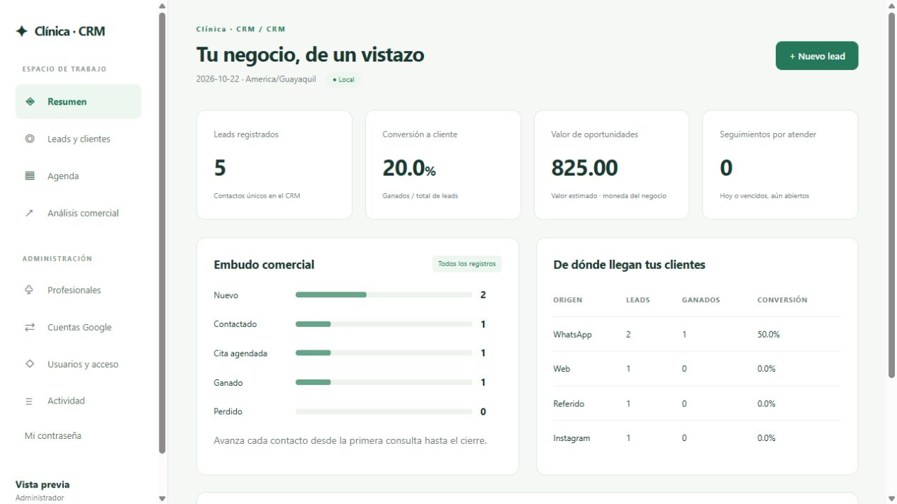

# CRM local de atención y reservas

## Desarrollo de la edición comercial

La edición comercial acordada está en planificación e implementación por fases. Las funciones
objetivo no deben confundirse con las disponibles actualmente. Para retomar el trabajo:

1. Leer [estado de continuidad](docs/producto/ESTADO.md).
2. Consultar [alcance y fases](docs/producto/PLAN.md).
3. Seguir el [proceso de instalación por cliente](docs/producto/REPLICACION.md).
4. Revisar el [reporte de P02](docs/producto/REPORTE_P02.md), el [diseño de la agenda](docs/producto/DISENO_P02.md)
   y la [evidencia de P02C](docs/producto/evidencias/p02c/). El historial de P01 está en
   [REPORTE_P01.md](docs/producto/REPORTE_P01.md).

El trabajo se realiza por entregas con cambios, pruebas y límites en el estado de continuidad.
P01 y P2 están aceptadas; G01 está **aceptada por Codex tras G01B**
([dictamen independiente](docs/producto/REVISION_G01B_CODEX.md)). P03 está implementada con
pruebas simuladas y conserva pendiente su validación en calendario real exclusivo autorizado.

## SaaS de reservas: modelo multi-tenant nativo

El chat de reservas con IA es un producto SaaS de despliegue multi-tenant: un
solo servidor atiende a N negocios y cada negocio es un **tenant lógico aislado**
mediante la columna `tenant_id` en toda tabla de negocio. No hay instalaciones
ni bases de datos separadas por cliente. Cada tenant dispone de su propia
identidad, catálogo de servicios, recursos, horarios, excepciones, FAQs y
políticas, todo configurable desde el panel web sin tocar código ni `.env`.

### Modelo de despliegue

- Un solo despliegue atiende a **N tenants**.
- El aislamiento es lógico, por `tenant_id`, con filtrado a nivel de fila en
  todas las consultas de negocio y claves foráneas compuestas
  `(tenant_id, id)` que impiden cruces accidentales entre negocios.
- Cada tenant tiene su propia configuración: identidad, catálogo, horarios,
  excepciones, FAQs y políticas.
- La configuración se gestiona mediante la API REST (`/api/...`) y el panel de
  administración; no se instala una copia por cliente.

---
P04–P08 siguen pendientes; el producto completo todavía no está terminado.

Aplicación local con acceso por contraseña, roles administrador/usuario, profesionales,
varias cuentas y calendarios Google, agenda y gestión comercial de leads. El bot de
WhatsApp existente se conserva y ahora puede consultar profesionales y guardar citas en el CRM.

## Funciones disponibles

| Área | Funciones |
|---|---|
| Acceso | Contraseña, administrador/usuario, desactivación y cierre de sesiones anteriores |
| Equipo | Alta y edición de profesionales, especialidades y correos |
| Agenda | Día/semana/mes, filtros, estados, asistencia, observaciones internas, historial e intervalos completos (fecha/hora de inicio y fin) |
| Google Calendar | Varias cuentas, calendarios independientes, estados de sincronización, conflictos en revisión y reintentos |
| Leads | Etapas comerciales, origen, responsable, notas, valor y seguimiento |
| Análisis | Embudo, conversión por origen y oportunidades abiertas |
| Administración | Gestión de usuarios y registro de actividad |



## Instalación reproducible en Windows

Python 3.11–3.13. Abra PowerShell en la raíz de este proyecto.

```powershell
python -m venv .venv-crm
.\.venv-crm\Scripts\python.exe -m pip install -r requirements-crm.txt
if (-not (Test-Path -LiteralPath .env)) { Copy-Item .env.example .env }
.\.venv-crm\Scripts\python.exe -c "import secrets; print(secrets.token_hex(32))"
```

`requirements-crm.txt` es la instalación mínima: Flask, SQLite y zona horaria. **No** instala
IA, Qdrant, Dash, Streamlit ni Google. Si va a sincronizar Google Calendar, instale el extra
opcional sobre el mismo entorno:

```powershell
.\.venv-crm\Scripts\python.exe -m pip install -r requirements-crm-sync.txt
```

Copie el resultado en `CRM_SECRET_KEY` dentro de `.env`. No lo publique. Sin una clave
configurada el servidor genera una temporal y las sesiones se cierran al reiniciar.
Configure `CRM_BUSINESS_NAME` y `CRM_TIMEZONE` si corresponde.

Si copió este repositorio desde otra carpeta o computadora, cree nuevamente el entorno virtual:
una carpeta `.venv-crm` copiada puede conservar rutas de la instalación anterior.

```powershell
.\.venv-crm\Scripts\python.exe -m flask --app crm.app:create_app create-admin
.\.venv-crm\Scripts\python.exe run_crm.py
```

Para verificar la entrega sin tocar el entorno del cliente, use un entorno aparte
(por ejemplo `.venv-verify`) y las dependencias de prueba; consulte la sección **Pruebas**.

Abra **http://127.0.0.1:8050** e ingrese con el correo y contraseña que acaba de crear.
La contraseña se pide en la terminal sin mostrarla. No existe una contraseña predeterminada.
Si el puerto está ocupado, cierre el dashboard anterior antes de iniciar el CRM.

No ejecute `app_corporativa.py` o `streamlit run ui/app.py` para acceder al CRM nuevo:
son interfaces anteriores con modelos diferentes. El inicio recomendado es `run_crm.py`.
El servidor escucha exclusivamente en localhost; no necesita VPS, Docker ni túneles.
La interfaz y los datos funcionan sin Internet. Google Calendar, WhatsApp y la IA sí requieren red.
El servidor de Flask se usa para una instalación local de una computadora; no publique este arranque en Internet.

## Primer uso

1. En **Usuarios y acceso**, cree administradores o usuarios. Contraseñas de 12–256 caracteres.
2. En **Profesionales**, agregue doctores, especialidades y correos. Puede dejarlos sin Google.
3. En **Leads y clientes**, registre contactos, origen, valor estimado, responsable y seguimiento.
4. Mueva cada lead entre Nuevo, Contactado, Cita agendada, Ganado y Perdido mediante Editar contacto.
5. En **Agenda**, elija Día, Semana o Mes; filtre por profesional/estado y cree citas desde un
   hueco. El formulario pide fecha y hora de inicio y de fin completas; se rechazan
   superposiciones por profesional y un fin anterior o igual en el mismo instante.
6. Use **Sincronizar Google** (administración) después de configurar las cuentas. La
   pestaña **Sincronización** (administración) muestra cada calendario, la cola de citas
   pendientes/con error/en revisión y un botón «Enviar ahora». Los errores de transporte
   reintentan solos con retirada; los conflictos con otros eventos de Google quedan en
   revisión hasta que una persona los resuelva.

Los usuarios gestionan todos los contactos y citas del negocio. Los administradores gestionan
además accesos, cuentas Google, profesionales, sincronización y auditoría. Los roles son
de un solo negocio: todavía no hay permisos por sucursal ni aislamiento por doctor.
Desactivar un usuario o cambiar su contraseña invalida sus sesiones anteriores.
La recuperación de acceso se hace creando un administrador desde la terminal; no se envían correos.

## Agenda visual, estados e historial

- Vistas **Día, Semana y Mes** en PC, tablet y móvil. En móvil se abre en Día; la vista elegida se
  recuerda durante la sesión y no cambia al redimensionar. La zona mostrada es siempre la del
  negocio (`CRM_TIMEZONE`), no la del navegador.
- Filtros por profesional y estado, y opción «Mostrar canceladas». Una celda libre abre el alta con
  fecha/hora/profesional cuando corresponde; en Mes se conserva la fecha pulsada y se piden las
  horas explícitas (sin inventarlas). La cita abre un panel lateral (escritorio) o a pantalla
  completa (móvil) con acciones e historial.
- El formulario representa el intervalo completo con fecha y hora de inicio y de fin. Al
  reprogramar se conservan ambos extremos (por ejemplo, una cita de 49 h no se acorta); se
  permiten horas de reloj iguales si las fechas son distintas (24 h) y se rechaza un fin
  anterior o igual en el mismo instante. La celda de 23:00 propone fin 00:00 del día siguiente.
- La rejilla muestra todas las citas válidas: amplía su rango horario (00–24) cuando hay reservas
  fuera de 07–20 o que cruzan medianoche. En Día/Todos los profesionales inactivos con citas
  aparecen en un carril de sólo lectura y no se pueden crear citas nuevas con ellos.
- En Mes cada cita se pinta en los días que realmente atraviesa y las continuaciones se marcan
  con `↪`/`↦`; «Ver más» abre el día.
- Estados operativos: Pendiente, Confirmada, Atendida, Cancelada y No asistió. «Pendiente de
  cierre» es una condición calculada cuando ya terminó una cita pendiente/confirmada; el reloj no
  marca asistencia.
- Antes del inicio se puede confirmar, reprogramar o cancelar. Reprogramar una confirmada la
  devuelve a Pendiente y guarda motivo y valores anteriores. Desde el fin se marca Atendida o No
  asistió y se añaden observaciones internas. Una cancelada no se reprograma ni se marca
  atendida: cree otra cita. Las correcciones excepcionales de estado son sólo de administración,
  con motivo obligatorio e historial; una cancelada no se «resucita».
- El estado de sincronización con Google se muestra separado del estado operativo. Si un evento
  desaparece de Google después de cerrar una cita como Atendida/No asistió, se conserva la
  asistencia, se marca «revisión pendiente» y se registra en el historial; no se reenvía
  automáticamente hasta que una persona intervenga. Los errores de transporte reintentables se
  marcan aparte y se reintentan.
- **Observaciones e historial son internos**: no se envían a Google, al bot ni a WhatsApp y no
  aparecen en el listado general de la agenda; sólo en el detalle autenticado de la cita.
- La edición usa versión optimista: un formulario desactualizado no sobrescribe una
  reprogramación o cancelación ni un cambio descargado de Google; se muestra el conflicto sin
  perder los datos escritos.
- La agenda usa JavaScript y estilos locales, sin CDN. La CSP permite `script-src 'self'` sin
  `unsafe-inline`/`unsafe-eval`. Navegación por teclado, Escape para cerrar, retorno de foco,
  contraste revisado y zoom 200 % están contemplados.

## Variables de configuración

| Variable | Uso |
|---|---|
| `CRM_SECRET_KEY` | Firma de sesiones; genere una clave propia y estable |
| `CRM_BUSINESS_NAME` | Nombre mostrado en el CRM |
| `CRM_TIMEZONE` | Zona IANA, por defecto `America/Guayaquil` |
| `CRM_ACCENT` | Color de acento del CRM en formato hex, por defecto `#18765b` |
| `CRM_DATABASE` | Ruta absoluta de SQLite; vacío usa `analitica.db` en la raíz |
| `CRM_PERFIL_NEGOCIO` | Ruta al perfil de negocio (JSON); vacío usa el perfil interno por defecto |
| `GOOGLE_CREDS_CENTRO`, `GOOGLE_CREDS_NORTE` | Ejemplos de variables que apuntan a JSON de cuentas de servicio |
| `WHATSAPP_APP_SECRET` | Firma de webhooks del backend opcional |
| `WHATSAPP_VERIFY_TOKEN` | Verificación inicial del webhook opcional |
| `CRM_API_TOKEN` | Token privado para las operaciones del backend opcional |

## Perfil de negocio (adaptar a otro rubro sin editar código)

El perfil es un JSON validado que describe la instalación: nombre operativo,
rubro, zona IANA, moneda, terminología del asistente y horario semanal
(día ausente = cerrado; `24:00` cierra el día). **Web y bot usan el mismo
perfil**: la misma regla acepta o rechaza un intervalo en ambos canales,
validando el horario completo (inicio y fin dentro de jornada).

```json
{
  "nombre": "Estética Aurora", "rubro": "servicios_con_citas",
  "rubro_etiqueta": "centro de estética", "zona": "Europe/Madrid", "moneda": "EUR",
  "horarios": {"0": ["09:00","19:00"], "1": ["09:00","19:00"], "2": ["09:00","19:00"],
               "3": ["09:00","19:00"], "4": ["09:00","19:00"], "5": ["09:00","13:00"]},
  "terminologia": {"paciente": "clienta"}
}
```

En `.env`: `CRM_PERFIL_NEGOCIO=H:/ruta/perfil.json` y reinicie. Ejemplos en
`perfiles/` (consultorio dental, servicios con citas en Madrid y una guardia
24×7 para pruebas). Un perfil mal formado impide arrancar con un error claro.
Las reglas afectan altas y reprogramaciones; las citas históricas no se tocan.
Una excepción fuera de horario exige administrador con motivo y queda en el
historial; el bot nunca puede pedir esa excepción. Feriados, catálogo de
servicios con duraciones y la pantalla de edición son fases posteriores: el
contrato está en `docs/producto/DISENO_G01.md`.

El CRM básico no necesita configurar WhatsApp, OpenRouter ni Qdrant. Reinicie el proceso
después de cambiar `.env`. Los archivos JSON y las claves se guardan en la computadora;
el formulario de cuentas Google recibe el nombre de la variable, no el contenido del JSON.

## Google Calendar con varios correos

1. Habilite Calendar API en su proyecto de Google Cloud y cree una cuenta de servicio.
2. Guarde su JSON localmente, por ejemplo `credentials/centro.json` (carpeta ignorada por Git).
3. Comparta cada calendario de los doctores con el `client_email` del JSON y permiso para modificar eventos.
4. En `.env`, agregue una ruta absoluta por cuenta:

```dotenv
GOOGLE_CREDS_CENTRO=H:/ruta/privada/centro.json
GOOGLE_CREDS_NORTE=H:/ruta/privada/norte.json
```

5. Reinicie el servidor. En **Cuentas Google**, registre nombre, correo de referencia y nombre de
   la variable (`GOOGLE_CREDS_CENTRO`, sin la ruta ni el contenido JSON).
6. En cada profesional seleccione la cuenta y el ID exacto de su calendario. Está en la
   configuración del calendario de Google, sección Integrar calendario. Un correo y un ID
   de calendario no siempre son iguales.

La sincronización es confiable por diseño: los cambios salen de una cola local sin
bloquear la agenda mientras se habla con Google; si la red falla, reintenta con retirada
(1, 5, 15, 60, 360 y 1440 minutos a partir del segundo fallo); si otro evento de Google
ocupa el hueco, la cita pasa a revisión y **no se reenvía sola** hasta que una persona
reprograme, cancele o pulse «Enviar ahora». Puede programar ciclos periódicos con
`flask --app crm.app:create_app sync-calendar` (Programador de tareas o cron).

## Base analítica (esquema estrella)

Una copia dimensional de solo lectura para reportes y herramientas BI (Power BI,
Excel, Metabase), construida desde el registro operativo **sin modificarlo**.
Botón «Reconstruir base analítica» en **Sincronización** (administración) o:

```powershell
python -m crm.analytics --source analitica.db --target analitica_bi.db
```

Contiene `fact_citas` (una fila por cita: duración, primera cita, cruce de
medianoche, sincronización) con `dim_fecha`, `dim_cliente`, `dim_profesional`,
`dim_estado` y `dim_origen`, más vistas listas (`vw_citas_por_dia`,
`vw_citas_por_profesional`, `vw_embudo_clientes`, `vw_primeras_vs_recurrentes`).
Fechas siempre en la zona del negocio. La reconstrucción es completa e
idempotente: `analitica_bi.db` (ignorado por Git) se borra y se crea de nuevo.

Una misma cuenta de servicio puede acceder a varios calendarios compartidos, incluso de correos
distintos. También puede usar varias cuentas de servicio. El correo de referencia del formulario
es una etiqueta administrativa; el JSON determina la identidad de autenticación. No se implementó
OAuth interactivo de Gmail ni acceso al correo electrónico. Vincular un correo no envía invitaciones.

### Comportamiento de sincronización

- Botón manual o comando local: `python -m flask --app crm.app:create_app sync-calendar`.
- Cada profesional tiene un calendario único; dos profesionales no pueden usar el mismo ID.
- Primero envía altas, reprogramaciones y cancelaciones locales pendientes; luego descarga Google.
- Descarga todas las páginas de eventos de los últimos 30 días y próximos 180 días.
- Usa intervalos reales, eventos de día completo, recurrencias expandidas e identidad por ID.
- Los eventos transparentes no bloquean la agenda. Los cambios pendientes locales prevalecen
  hasta enviarse; los eventos ya sincronizados reflejan la versión de Google.
- Una descarga incompleta no libera las citas locales. Los errores conservan el cambio para reintento.
- Un ID estable evita duplicar una cita cuando se pierde la respuesta a una creación.
- La descarga no reinicia la asistencia ni borra observaciones internas. Una cita cancelada
  localmente no se reactiva por reaparecer en Google.
- Los cambios externos relevantes (título, horario, cancelación) incrementan la versión de la
  cita y quedan en el historial; una descarga idéntica no invalida ediciones abiertas.
- Si un evento desaparece de Google y la cita local ya está Atendida o No asistió, se conserva el
  estado, se marca **revisión pendiente** y se añade historial. Ese conflicto queda **excluido**
  de los reenvíos automáticos hasta que una persona reprograme, cancele o corrija la cita.
- Los fallos de transporte (red, 5xx) se marcan como error reintentable y se vuelven a intentar;
  no se confunden con una revisión de conflicto.
- Si otra persona ocupó el horario en Google, el cambio local queda con error: reprogramar o cancelar
  desde el CRM y volver a sincronizar. No se promete atomicidad con otros editores externos de Google.
- Las citas de profesionales sin calendario son locales; no se envían hasta configurar Google.
- Las notas y los estados internos nunca se envían a Google, al bot ni a WhatsApp.
- El ID de calendario de un profesional con citas no puede cambiarse: cree otro profesional para otra agenda.
- La sincronización puede tardar; hay bloqueo de escritura SQLite por profesional mientras se procesa.
  No use varios procesos de sincronización a la vez. Las citas fuera de la ventana conservan su historial,
  pero sus cambios externos no se descargan hasta entrar en la ventana.

Para automatizar localmente, use el Programador de tareas de Windows con intervalo de 5 minutos,
programa `H:\ruta\proyecto\.venv-crm\Scripts\python.exe`, argumentos
`-m flask --app crm.app:create_app sync-calendar` y directorio inicial `H:\ruta\proyecto`.
Marque que no inicie una nueva instancia si ya hay otra ejecutándose. La computadora debe estar encendida.

## Bot existente y datos anteriores

El CRM crea solamente tablas `crm_*` en `analitica.db`, o en la ruta absoluta `CRM_DATABASE`.
No borra ni transforma `turnos`, `interacciones`, `mensajes`, `tratamientos` o `clinica.db`.
Tampoco genera datos de demostración automáticamente.

Con el CRM ya inicializado, cada mensaje recibido que pasa por `guardar_mensaje` crea un lead
WhatsApp por teléfono si todavía no existe. No sobrescribe nombres, responsables o etapas existentes.
Si define `CRM_DATABASE`, el bot debe cargar el mismo `.env`.

El bot expone `listar_profesionales`. Cuando hay varios debe pedir al paciente que elija y usar
`professional_id`. Con un profesional activo lo selecciona automáticamente. Las reservas se guardan
en el CRM y se envían a Google en la siguiente sincronización, informando que están pendientes.
La disponibilidad combina las citas locales y Google cuando puede consultarlo. Si no hay profesionales
CRM, se mantiene el calendario general anterior (`CALENDAR_ID` / `GOOGLE_APPLICATION_CREDENTIALS`).
Los horarios y mensajes del bot anterior siguen siendo dentales y deben adaptarse al nuevo negocio;
el CRM permite la gestión manual de horarios sin esas reglas del bot.

Los registros históricos no se importan automáticamente: el dashboard anterior podía generar datos
demo en la misma tabla de analítica. Agregue al profesional con su calendario real y sincronice para
recuperar las citas de Google dentro de la ventana. Las reservas antiguas sin ID de Google requieren
revisión manual antes de recrearlas para evitar duplicados. Conserve una copia de las bases antiguas.

El conjunto anterior con Dash/Streamlit y el bot conserva `requirements.txt`. La comprobación de
instalación desde cero para Python 3.12 detectó conflictos entre sus dependencias: **ese archivo
todavía requiere ajustes antes de considerarlo reproducible**. No lo instale encima del entorno
del CRM nuevo. El CRM mínimo usa `requirements-crm.txt` (Flask, python-dotenv, tzdata),
`requirements-crm-test.txt` (pruebas) y `requirements-crm-sync.txt` (Google opcional); su
resolución se verificó en un entorno nuevo para Python 3.13 sin modificar los paquetes instalados.
La configuración y límites del bot se detallan en [el diagnóstico](docs/AUDITORIA.md);
el arranque del CRM no inicia ni expone ese backend.

Si activa el backend anterior, configure `WHATSAPP_APP_SECRET` para validar la firma de Meta y
`WHATSAPP_VERIFY_TOKEN` para el alta del webhook. Las rutas `/api/chat` y `/api/responder` requieren
`CRM_API_TOKEN` mediante la cabecera `X-CRM-Token`; no reutilice la contraseña de un usuario ni
publique ese token en el navegador. El token de prueba fijo fue eliminado. Los clientes antiguos
del dashboard deben añadir esa cabecera para continuar accediendo al backend.

## Copias de seguridad y restauración

Detenga el CRM, el bot y cualquier tarea de sincronización antes de copiar o restaurar datos.
Copia el archivo SQLite mientras los procesos están detenidos; no copies una base en uso.

**Respaldo consistente recomendado** (un solo archivo autocontenido, sin depender de `-wal`/`-shm`):

```powershell
.\.venv-crm\Scripts\python.exe -c "import sqlite3; s=sqlite3.connect(r'analitica.db'); d=sqlite3.connect(r'backups\respaldo-consistente.db'); s.backup(d); d.close(); s.close()"
```

La API `backup` de SQLite (o `.backup` / `VACUUM INTO`) produce una copia coherente aunque la base
use WAL. Guarde `.env` y los JSON de Google por separado en un lugar privado; no los incluya en Git.

**Si copia los archivos a mano** con los procesos detenidos, copie la base junto con sus propios
`-wal` y `-shm` de la **misma generación**. Nunca mezcle una base con un WAL/SHM de otra copia.

**Restauración:**

1. Detenga CRM, bot y sincronización.
2. Retire la base actual y **cualquier** `-wal`/`-shm` que le pertenezca (restos de la generación
   anterior). No deje un WAL ajeno junto al archivo restaurado.
3. Reponga el respaldo consistente en su ruta (o la base con su WAL/SHM del mismo respaldo).
4. Arranque el CRM; las migraciones pendientes se aplican de forma idempotente.
5. Mantenga la misma `CRM_SECRET_KEY` o vuelva a iniciar sesión.

Nunca use datos reales como datos demo. Ensaye la restauración con una copia ficticia antes de
depender de ella; la prueba automatizada
`tests/test_p01b.py::test_sqlite_backup_and_restore_without_foreign_wal` reproduce este recorrido
(ver `REPORTE_P01.md`).

El CRM versiona su propio esquema en la tabla `crm_migrations` y **no** modifica
`PRAGMA user_version` de las tablas anteriores. Cada migración y su registro de versión son
atómicos y la aplicación de versiones se serializa entre inicializaciones concurrentes. La
versión 2 añade el estado operativo, la versión optimista y las tablas de observaciones e
historial; conserva filas, índices, claves foráneas y `origin=demo`.

## Pruebas

El CRM mínimo **no** requiere Pydantic ni dependencias del bot: las fixtures comparten una
importación diferida. Para verificar sin tocar `.venv-crm`, cree un entorno aparte:

```powershell
python -m venv .venv-verify
.\.venv-verify\Scripts\python.exe -m pip install -r requirements-crm-test.txt
.\.venv-verify\Scripts\python.exe -m pytest tests/test_crm.py tests/test_reservation_service.py tests/test_demo_seed.py tests/test_p01b.py tests/test_p02.py tests/test_p02b.py tests/test_p02c.py tests/test_p03.py tests/test_analytics.py tests/test_business_profile.py tests/test_g01_reservas.py -q --basetemp=.pytest_cache/pruebas-crm
```

Si pip hereda una ruta CA inválida, apunte `PIP_CERT`, `REQUESTS_CA_BUNDLE` y `SSL_CERT_FILE`
a un `cacert.pem` válido (por ejemplo el de `certifi`) **sólo** para ese comando.

Las pruebas usan SQLite temporal y Google simulado: no crean citas reales ni envían mensajes.
Si el entorno restringe la carpeta temporal, use `--basetemp=.pytest_cache/una-carpeta-nueva`.
La suite de reservas incluye concurrencia real por horario, rollback por FK/auditoría y validación
de horas locales inexistentes/ambiguas. `tests/test_p01b.py` cubre atomicidad y serialización de
migraciones, `user_version` legacy y respaldo/restauración consistente. `tests/test_p02.py`
cubre migración v2, transiciones con reloj controlado, versión obsoleta, API/permisos, historial,
privacidad de notas, Google simulado y rangos medianoche/mes/DST. `tests/test_p02b.py` cubre
versionado ante cambios externos, cancelación sin/con versión obsoleta, revisión persistente
frente a reintentos, citas fuera de franja/medianoche y profesionales inactivos en la API.
`tests/test_p02c.py` cubre intervalos completos (49 h, 24 h con igual hora, 23:00–00:00 y
23:00–01:00), fin inválido y filtro por día con cruce de medianoche. `tests/test_p03.py`
cubre la migración v3 de reintentos, la red fuera de transacciones (sonda real de
bloqueo), la retirada 0→1→5 min con filtro de vencimiento, conflicto→revisión con
reenvío manual, arriendos entre procesos y la pestaña/permisos de sincronización.
`tests/test_analytics.py` cubre la estrella: cuadre contra el operacional,
medidas (duración, primera cita, cruce de medianoche), zona del negocio,
idempotencia y permisos del botón de reconstrucción.

La fixture de `tests/conftest.py` importa `database.db_manager` de forma diferida pero **sin**
omitir errores: las suites del bot que lo necesitan fallan con el error de importación real si
falta Pydantic. El subconjunto mínimo del CRM no lo usa y sigue pasando sin Pydantic.

Para las pruebas del bot y de las herramientas de calendario, use un entorno con
`requirements.txt` (incluye Google y las dependencias anteriores):

```powershell
.\.venv\Scripts\python.exe -m pytest tests/test_calendar_tool.py tests/test_demo_seed.py -q
```

Los tiempos y conteos reales de cada entrega se registran en
[`docs/producto/REPORTE_P02.md`](docs/producto/REPORTE_P02.md),
[`docs/producto/REPORTE_P01.md`](docs/producto/REPORTE_P01.md) y
[`docs/producto/ESTADO.md`](docs/producto/ESTADO.md). No se reutilizan conteos históricos.

Para regenerar la evidencia visual de la agenda en un entorno con Playwright y Chromium:

```powershell
python tools/evidencia_p02.py
python tools/evidencia_p02b.py
python tools/evidencia_p02c.py
```

Crean bases ficticias temporales en `.pytest_cache/` y capturas en
`docs/producto/evidencias/p02/`, `docs/producto/evidencias/p02b/` y
`docs/producto/evidencias/p02c/` (360/768/1440, zoom 200 %, consola y resumen). La evidencia
P02B incluye horas 05–06, 21–22, 23–01, evento previo al rango, profesional inactivo, alta desde
Mes, detalle/historial y carrera de vistas. P02C cubre intervalos de 49 h/24 h, medianoche,
fin inválido y el payload real del formulario. Playwright es una
herramienta de verificación, **no** una dependencia del producto; no se instala en `.venv-crm`.

## Problemas frecuentes

| Problema | Acción |
|---|---|
| No puede ingresar en la primera instalación | Ejecute `create-admin` desde la terminal y use esos datos |
| El puerto 8050 está ocupado | Detenga el dashboard anterior o el proceso CRM duplicado |
| La sesión se cierra al reiniciar | Configure una `CRM_SECRET_KEY` estable |
| Google indica 403 o 404 | Revise el ID del calendario, la cuenta de servicio y los permisos compartidos |
| Una cita queda pendiente o con error | Revise el detalle en Agenda, corrija la causa y vuelva a sincronizar |
| Una cita muestra «revisión» de Google | No se reenvía sola: revise el conflicto, reprograme/cancele/corrija y sincronice |
| El bot devuelve 401 o 503 | Revise `CRM_API_TOKEN`, la cabecera `X-CRM-Token` y los secretos del webhook |
| pip busca un certificado CA inexistente | Revise `PIP_CERT`, `REQUESTS_CA_BUNDLE` y `SSL_CERT_FILE`; configure un CA válido manteniendo HTTPS |

La agenda se presenta en vistas Día, Semana y Mes con filtros por profesional/estado. Los datos
históricos locales no se migran automáticamente, y el sistema representa un solo negocio por
instalación. Consulte el diagnóstico para los pendientes de la cola del bot, audio, horarios por
profesional y otras extensiones.

## Datos ficticios para probar la agenda

Ejecute en la raíz del proyecto, con el CRM ya inicializado:

```powershell
.\.venv-crm\Scripts\python.exe seed_demo_crm.py
```

El script crea tres profesionales locales identificados con `[DEMO]`, 60 contactos ficticios
y reservas de una hora entre las 08:00 y las 18:00 durante los próximos diez días laborables.
Deja aproximadamente un 10 % de horarios libres y omite las horas que ya pasaron.
Todos los correos usan el dominio `.invalid` y los teléfonos no son números utilizables.
Los datos previos y los usuarios se conservan; antes de cargar se crea una copia SQLite
consistente en `backups/crm-antes-demo-*.db`, incluso si el CRM está abierto.

Las citas tienen `origin=demo` y quedan excluidas del envío a Google, incluso después de
editarlas. Los profesionales de prueba se crean sin cuentas ni calendarios conectados.
No los use para reservas reales. Repetir la carga el mismo día conserva las reservas ya
existentes sin duplicarlas; ejecutarla otro día puede añadir fechas nuevas a la ventana.

Actualice la página del navegador para ver los registros. Puede filtrar por profesional
en Agenda y probar una reserva nueva en los huecos que quedan libres.

Prueba aislada del generador y de la exclusión de Google:

```powershell
.\.venv-crm\Scripts\python.exe -m unittest tests.test_demo_seed -v
```

## Documentación para recrear y adaptar

- [Arquitectura y extensión](docs/ARQUITECTURA_CRM.md).
- [Diagnóstico, correcciones y pendientes](docs/AUDITORIA.md).
- [Guía para otro negocio](docs/ADAPTAR_NEGOCIO.md).
