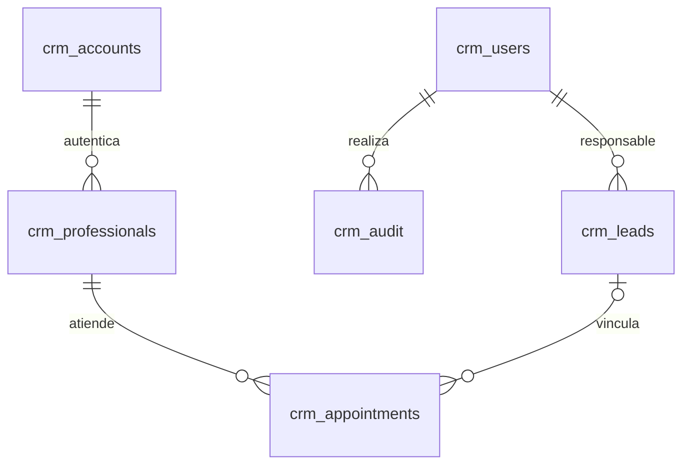

# Arquitectura del CRM local

## Decisiones

Se agregó un módulo `crm/` en Flask con plantillas Jinja y CSS local. Dash ya depende de Flask,
pero el CRM tiene un archivo de dependencias propio para poder instalarse sin IA. Se evitó requerir
Node, recursos CDN o un VPS. Las escrituras usan formularios POST, CSRF y comprobación de roles en servidor.
La primera cuenta se crea en terminal y las siguientes desde administración.

Las tablas nuevas tienen prefijo `crm_`. Esta separación preserva el trabajo anterior y evita
interpretar turnos generados o métricas ficticias como citas reales. No hay migración destructiva.
Los archivos preexistentes `app_corporativa.py`, `skills/` y `trabajo_vps/` no se reemplazaron.

## Módulos

| Archivo | Responsabilidad |
|---|---|
| `run_crm.py` | Inicio exclusivo en `127.0.0.1:8050` |
| `crm/app.py` | Factory, autenticación, rutas, autorización y comandos CLI |
| `crm/store.py` | Esquema, conexiones transaccionales y auditoría |
| `crm/calendar.py` | Sincronización por profesional y adaptación a UTC |
| `crm/integration.py` | Captura de leads y reservas del bot hacia el CRM |
| `crm/templates/` | Login, navegación, agenda, embudo y administración |
| `crm/static/crm.css` | Diseño adaptable, tipografía del sistema, estilos locales |
| `api/agent.py` | Bot anterior con selección opcional de profesional |
| `tools/analitica.py` | Historial anterior y captura de nuevos contactos |
| `tools/calendar_tool.py` | Calendario general anterior; zona horaria y paginación corregidas |

## Datos

Las contraseñas se almacenan con hash scrypt y sal aleatoria. Las cookies llevan firma, HttpOnly,
SameSite Strict y vencimiento de 8 horas. El contador `session_version` permite revocar las sesiones
al cambiar contraseña o desactivar un usuario. Cinco intentos fallidos bloquean durante 15 minutos
por IP y por correo. Al ser HTTP local, la cookie no usa Secure. Para un despliegue remoto habría que
agregar HTTPS, servidor de producción, gestión de secretos y una revisión del backend anterior.

Los timestamps de citas se normalizan a UTC con offset explícito y se convierten a la zona IANA
configurada para mostrarse. El teléfono es la identidad comercial normalizada (7–15 dígitos).
Una fila de lead es un contacto, no una conversación ni una oportunidad independiente por servicio.

## Agenda y consistencia

Toda reserva local comprueba `inicio_existente < fin_nuevo AND fin_existente > inicio_nuevo`
dentro de `BEGIN IMMEDIATE`. Por tanto las citas contiguas son válidas, las superpuestas se rechazan
y dos profesionales pueden atender al mismo tiempo. Reprogramar mantiene la identidad remota.
Cancelar conserva la fila y envía la cancelación en la siguiente sincronización.

Los estados de envío son `pending`, `error` y `synced`. Los errores se guardan, no equivalen a
confirmaciones. Un UUID hexadecimal se usa como ID de Google al crear para que los reintentos
conserven identidad. La descarga usa todas las páginas dentro de la ventana y sólo reconcilia
ausencias después de descargarla completa. Se usa PATCH para conservar otros campos remotos.
Las transacciones por profesional evitan sobrescribir una edición local concurrente mientras se
sincroniza, a cambio de mantener bloqueo de escritura durante las llamadas a Google.

La API de Google no proporciona una transacción de reserva compartida con SQLite. La consulta de
conflictos reduce las superposiciones remotas, pero otro editor puede crear un evento simultáneamente.
Si se requiere garantía entre múltiples sistemas, se necesita una política de reservas centralizada.

Referencia: [identidad de eventos](https://developers.google.com/workspace/calendar/api/v3/reference/events/insert)
y [paginación y filtros](https://developers.google.com/calendar/api/v3/reference/events/list).

## Métricas

- Conversión: contactos en Ganado / todos los contactos registrados.
- Valor de oportunidades: suma de valores estimados de etapas abiertas. No equivale a ingresos cobrados.
- Seguimientos: fecha menor o igual a hoy, excluyendo Ganado y Perdido.
- Orígenes: cantidad y conversión por el texto de origen registrado.

Son métricas comerciales de todos los registros, no análisis clínico, contabilidad o cohortes temporales.
Cambiar manualmente una etapa modifica estas métricas; no existe todavía un historial del embudo.

## Extensiones y mantenimiento

Para nuevas entidades agregue una tabla con prefijo `crm_`, una migración explícita, una ruta protegida,
plantilla y pruebas de autorización. El esquema inicial usa `CREATE TABLE IF NOT EXISTS`; una nueva
columna requiere una migración versionada, no basta con editar el CREATE. No reutilice `user_version`
como versión de otras bases antiguas sin revisar el contenido.

Para cambiar permisos, revise el decorador `protected` y las rutas, no solamente la navegación.
Para migrar de SQLite a otro motor, extraiga las consultas de las rutas y cambie `store.py` junto
con transacciones, ON CONFLICT e índices. La arquitectura actual está diseñada para una computadora
y un solo negocio. No es multiempresa ni una solución de historia clínica.
