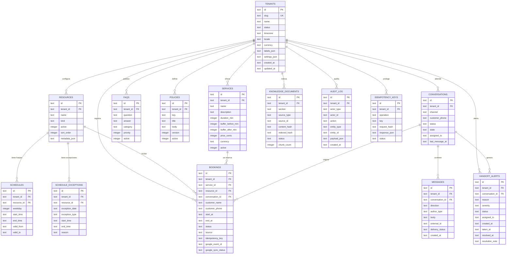

# Modelo de datos — Fase 1

Fecha: 2026-10-25
Motor de la entrega: SQLite 3.45+ (WAL)
Migraciones: `saas/migrations/0001_tenancy_and_config.sql` y
`saas/migrations/0002_conversations_bookings.sql`

## Principios

1. **Multi-tenant por columna.** Toda tabla de negocio tiene `tenant_id NOT NULL`
   con índice propio.
2. **Aislamiento en la base.** Las referencias internas usan claves foráneas
   compuestas `(tenant_id, id)` contra `UNIQUE (tenant_id, id)` en la tabla
   padre. Un ID del tenant A no puede referenciarse desde el tenant B.
3. **Historial protegido.** Las reservas no se borran al desactivar un servicio
   o un recurso: `bookings` usa `ON DELETE RESTRICT`.
4. **Fechas en UTC.** `created_at`, `updated_at`, `start_at`, `end_at` son texto
   ISO-8601 UTC (`2026-10-25T09:00:00.000Z`). La zona del negocio vive en
   `tenants.timezone` y se aplica en dominio.
5. **Dinero entero.** `price_cents` en centavos y `currency` ISO-4217.

## Diagrama ER



> Nota: `knowledge_documents.source_id` es polimórfico (apunta a `services.id`,
> `faqs.id` o `policies.id` según `section`), por eso no tiene FK física. La
> integridad se garantiza en el pipeline de indexación de la Fase 5.

## Descripción de tablas

### `tenants`

Negocio raíz. `slug` es único global y se usa en URLs. `labels_json` permite
cambiar el vocabulario (servicio/tratamiento, profesional/doctor, cita/reserva)
sin tocar código. `settings_json` guarda preferencias (sonido de alertas,
onboarding completado, reserva pública). `status` es `active`, `paused` o
`deleted`; el borrado físico está bloqueado por `RESTRICT`.

### `resources`

Profesionales, salas o cualquier recurso reservable. `kind` es libre
(`professional`, `room`, `chair`...). `active` permite retirarlo sin romper
reservas históricas. `UNIQUE (tenant_id, name)` evita duplicados.

### `services`

Catálogo. `duration_min` es la duración base; los buffers se suman al calcular
slots. `price_cents` es el precio configurado y es la única fuente válida para
el guardrail de precios. `active = 0` retira del catálogo sin borrar filas.

### `schedules`

Franjas semanales recurrentes por recurso. `weekday` usa 0 = lunes y 6 =
domingo. `start_time`/`end_time` son `HH:MM` en la zona del tenant. `valid_from`
y `valid_to` permiten cambios estacionales sin borrar historial.

### `schedule_exceptions`

Excepciones puntuales: `closed` (cierre todo el día, horas nulas), `extra`
(franja adicional) o `modified` (franja sustituta). `resource_id` es obligatorio;
un cierre general se replica por recurso.

### `faqs` y `policies`

Contenido editable por el dueño. Las FAQs se recuperan por RAG; las políticas
(cancelación, reprogramación, privacidad) se inyectan además en el prompt y en
las reglas del motor. `policies.key` es único por tenant y `version` permite
versionar el texto.

### `knowledge_documents`

Metadatos de indexación incremental. `section` es `faqs`, `catalog` o
`policies`; `source_id` identifica la fila de origen. `content_hash` cambia
cuando cambia el contenido; `indexed_hash` permite saber qué versión está en el
vector store. `status` es `pending`, `indexed`, `stale` o `error`. La Fase 5
rellena `chunk_count`, `embedding_model` y `last_indexed_at`.

### `conversations`

Estado del diálogo por cliente y canal. `status` es el estado operativo
(`idle`, `pending_human`, `closed`); `state` es el estado del flujo
(`collecting_service`, `confirming`, `booked`...). `assigned_to` identifica al
humano que tomó el caso. El bot no puede resolver una conversación
`pending_human`; sólo una acción humana la devuelve a `idle`/`closed`.

### `messages`

Historial completo. `direction` (`in`/`out`) y `author_type`
(`customer`/`bot`/`human`/`system`) separan mensajes del cliente, del bot y
notas humanas. `external_id` es el ID del proveedor (WhatsApp) y es único por
tenant cuando existe. `delivery_status` refleja el estado del canal.

### `bookings`

Reserva. `start_at`/`end_at` en UTC; `CHECK (end_at > start_at)`. `status` es
`pending`, `confirmed`, `cancelled`, `completed` o `no_show`. `source` indica el
canal de creación. `idempotency_key` es único por tenant cuando no es nulo.
`google_sync_status` empieza en `disabled`: el calendario interno es la fuente
de verdad.

### `handoff_alerts`

Alerta persistente del dashboard. `status`: `pending -> in_progress ->
resolved`. `severity`: `low`, `medium`, `high`, `urgent`. La base exige que una
alerta `in_progress` tenga `taken_at` y que una `resolved` tenga `taken_at`,
`resolved_at` y `resolution_note` no vacía. La alerta no se borra al resolver:
queda como historial.

### `audit_log`

Auditoría append-only por tenant. `actor_type` es `human`, `bot` o `system`.
`payload_json` guarda el cambio. Se escribe en la misma transacción que la
operación cuando la Fase 2+ lo requiera.

### `idempotency_keys`

Protección de operaciones repetidas. Clave única `(tenant_id, operation, key)`
para `book`, `cancel` y `reschedule`. `request_hash` detecta reutilización de la
clave con datos distintos; `response_json` permite devolver la respuesta
original. Se implementa en el motor de la Fase 4.

## Claves foráneas y `ON DELETE`

| Tabla hija | Tabla padre | Política |
|---|---|---|
| todas las tablas de negocio | `tenants` | `RESTRICT` (borrado lógico) |
| `schedules` | `resources` | `CASCADE` |
| `schedule_exceptions` | `resources` | `CASCADE` |
| `messages` | `conversations` | `CASCADE` |
| `handoff_alerts` | `conversations` | `CASCADE` |
| `bookings` | `services` | `RESTRICT` |
| `bookings` | `resources` | `RESTRICT` |
| `bookings` | `conversations` | `RESTRICT` |

Las FK compuestas incluyen `tenant_id`, por lo que la política se aplica también
al aislamiento: no se puede borrar un recurso del tenant A mientras una reserva
del tenant B lo referencie (lo cual, además, sería imposible por la FK
compuesta).

## Índices y restricciones relevantes

- `tenants.slug` único.
- `resources (tenant_id, name)` único.
- `services (tenant_id, name)` único.
- `faqs (tenant_id, id)` único.
- `policies (tenant_id, key)` único.
- `knowledge_documents (tenant_id, section, source_id)` único.
- `messages (tenant_id, external_id)` único parcial cuando `external_id` no es
  nulo.
- `bookings (tenant_id, idempotency_key)` único parcial cuando la clave no es
  nula.
- `idempotency_keys (tenant_id, operation, key)` único.
- Índice de rango para disponibilidad: `bookings (tenant_id, resource_id,
  start_at, end_at)`.
- Índice para el dashboard: `handoff_alerts (tenant_id, status, created_at)`.
- Índice por sección para reindexar: `knowledge_documents (tenant_id, section,
  status)`.

La prevención de solapes por intervalo no se puede expresar como constraint en
SQLite. Se implementará con `BEGIN IMMEDIATE` + consulta de solapes + índice de
rango en la Fase 4. Si se adopta PostgreSQL, se añadirá una restricción
`EXCLUDE USING gist`.

## Migraciones

```bash
# Aplicar migraciones pendientes
python -m saas.db --db data/saas.db

# Seed idempotente del consultorio dental demo
python scripts/seed_demo_saas.py --db data/saas.db
```

Cada migración se aplica en una transacción junto con su fila en
`saas_schema_migrations`. El runner guarda un checksum SHA-256: si un archivo ya
aplicado cambia, `migrate()` falla en lugar de aplicar un esquema distinto en
silencio. `PRAGMA foreign_keys=ON` se activa en cada conexión.

## Seed demo

`demo-dental` crea:

- 1 tenant (`Clínica Dental Demo`, `Europe/Madrid`, EUR).
- 2 profesionales.
- 3 servicios (consulta gratuita, limpieza 60 EUR, blanqueamiento 250 EUR).
- 20 franjas semanales (lunes a viernes, dos bloques por profesional).
- 2 excepciones de cierre (25 de diciembre).
- 5 FAQs y 3 políticas.
- 11 documentos de conocimiento en estado `pending`.
- 0 conversaciones, 0 reservas y 0 alertas: el dashboard arranca limpio.

Los IDs son UUIDv5 deterministas y las inserciones usan `INSERT OR IGNORE`, de
modo que ejecutar el seed dos veces conserva los conteos.

## Aislamiento verificado

La prueba `tests/test_saas_phase1.py::test_two_tenants_are_isolated_in_repository_queries`
crea dos tenants y comprueba:

- lecturas de servicios, FAQs y reservas sólo devuelven filas del tenant
  solicitado;
- una actualización de precio con el tenant equivocado no modifica nada;
- una conversación del tenant A no se obtiene desde el tenant B;
- una reserva del tenant B que referencia un servicio del tenant A es rechazada
  por la FK compuesta.
